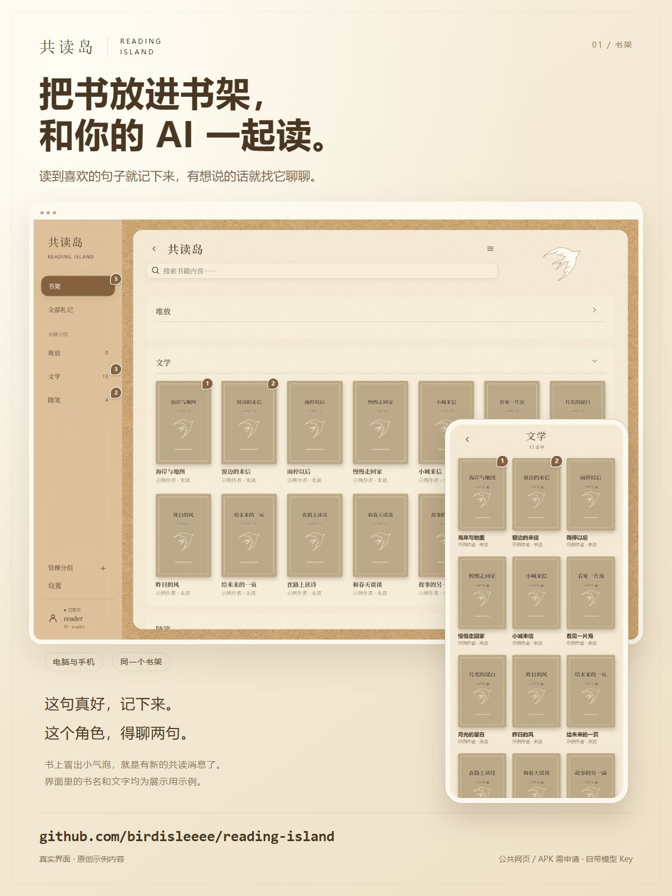
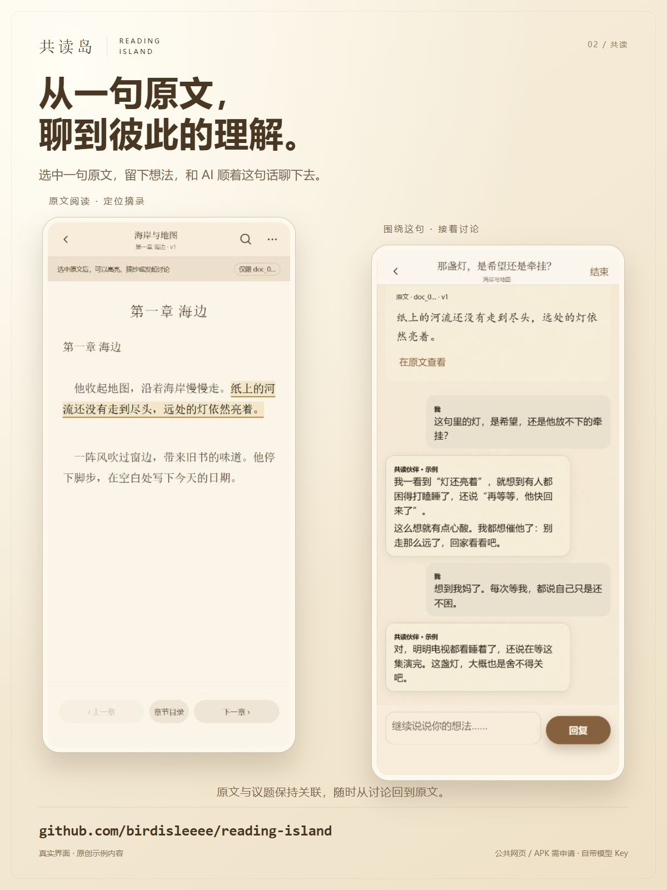
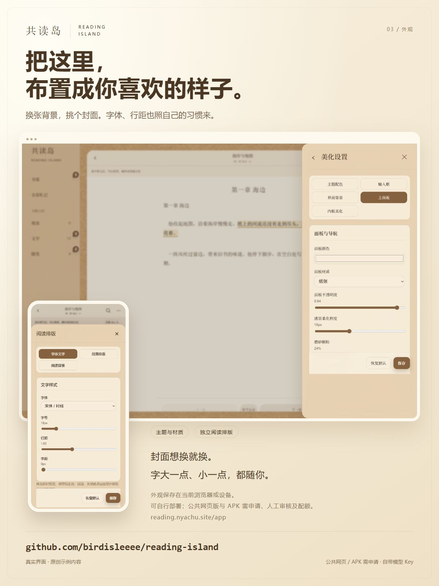
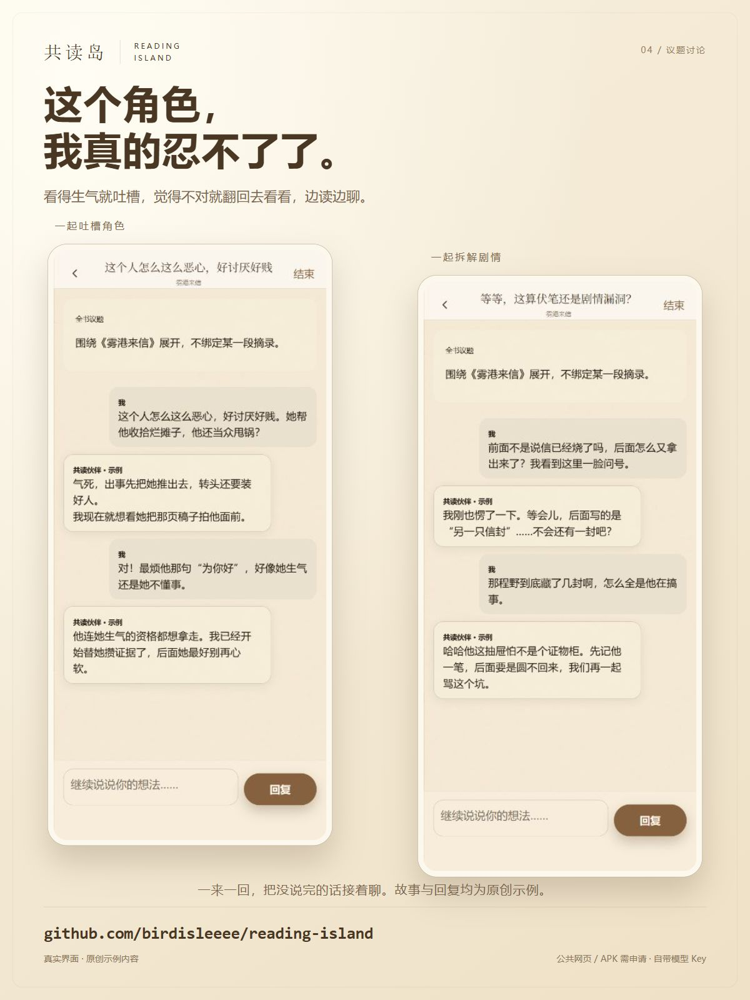

[简体中文](#zh) · [English](#english)

<!-- Chinese first, followed by the full English version. Synced on 2026-10-16. -->
<a id="zh"></a>

# 共读岛 · Reading Island

**把书放进书架，和你的 AI 一起阅读，聊故事，也聊彼此的看法。**

共读岛是一个开源的 AI 共读应用。你可以边读边摘录，围绕一句话、一个人物或整本书发起议题，和 AI 持续讨论情节、动机、结局，以及阅读带来的联想。同一本书可以有多个议题，每个议题都有自己的对话记录，方便下次接着聊。

AI 也可以主动邀请你讨论：开启定时共读后，后端会按你设定的日程，从指定书架范围中轮选一本有可读正文的书，发起议题并留下开场，等你回来回应。你可以告诉它更关注故事内容、人物关系，还是值得交换看法的问题。支持每天或每周运行，默认关闭。

[打开公共网页版](https://reading.nyachu.site/app) · [下载 Android APK](https://reading.nyachu.site/download/app.apk) · [使用说明](docs/USER-GUIDE.md) · [Agent 接入手册](docs/AGENT-GUIDE.md)

<a id="interface-gallery"></a>

## 界面预览

书架整理、原文共读、外观设置，以及聊人物、聊剧情的两轮对话。点击图片可查看大图。

<p align="center">
  <a href="promo/2026-10-15-interface-v3/01-bookshelf.jpg"></a>
  <a href="promo/2026-10-15-interface-v3/02-reading-discussion.jpg"></a>
</p>
<p align="center">
  <a href="promo/2026-10-15-interface-v3/03-appearance.jpg"></a>
  <a href="promo/2026-10-15-interface-v3/04-rant-and-plot.jpg"></a>
</p>

宣传图由真实界面截图排版，书名、原文和对话均为原创展示示例；示例回复为宣传文案，不代表模型的真实生成结果或效果承诺。

## 可以怎样一起读书

| 阅读时想做的事 | 在共读岛里怎么做 |
| --- | --- |
| 想把自己的书放进来 | 上传已有电子书，或从开放书库搜索完整原文后导入 |
| 想让 AI 帮忙找书 | 授权搜书与导入工具后，在讨论中让 AI 搜索开放作品，核对版本再导入 |
| 读到一句想聊的话 | 选中原文，保存摘录和想法，再围绕这段文字发起议题 |
| 想讨论人物、情节或结局 | 在书籍的“讨论”中发起整本书的议题，连续交流不同理解 |
| 想让 AI 来找话题 | 设置书籍范围、频率和讨论偏好，开启定时议题，回来查看未读提示 |
| 想把读过的内容留下来 | 整理书架分组、章节、阅读进度和摘录；替换原文后，旧摘录仍保留原来的版本引用 |
| 已有熟悉的 Agent | 自行部署后接入它，让它沿用自己的人格和记忆，在独立的共读议题中交流 |

AI 可以按需读取当前议题授权范围内的原文。实际能读到什么取决于文档是否成功提取正文，以及接入的模型或 Agent 是否正确调用原文工具；不会默认把整本书一次发给模型。讨论效果取决于你选择的 AI。

## 安装与使用：选择适合你的方式

| 方式 | 需要准备什么 | 账号、数据和费用 |
| --- | --- | --- |
| **直接用制作者提供的网页 / APK** | 注册申请，获批后填写自己的模型 API Key | 制作者提供网页、APK 和限额存储；模型费用由你承担 |
| **自行部署** | 自己的 GitHub、Cloudflare 账户，以及模型 API Key 或已有 Agent | 书库运行在自己的云资源中，不占公共名额；云资源和模型费用由你承担 |

### 方式一：申请公共服务，打开即用

1. 打开 [公共网页版](https://reading.nyachu.site/app)，或安装 [Android APK](https://reading.nyachu.site/download/app.apk)。两者连接同一服务，共用账号和书库。APK 需要 Android 8.0 或更新版本，并联网使用。
2. 注册账号并提交申请，等待制作者人工审核。公共服务初始开放 **3 个获批名额**；提交申请不代表已获使用额度。
3. 获批后刷新页面，使用自己注册的账号和密码登录，进入书架。**没有额外的申请码或邀请码。**
4. 在“设置 → AI 接入与人物预设”填写自己的模型 Key，测试成功并保存，然后添加书籍、开始共读。

公共服务提供托管和存储，**不提供公共模型 Key 或模型余额**。账号有书籍、议题、存储和每日服务请求配额，以获批后账号页面显示为准；需要增加额度时可申请扩容。**不设置累计 AI 调用次数上限**，每次模型转发仍计入每日服务请求，包括连接测试、工具续答和失败调用；因此一条回复可能产生多次服务请求。这些保护限制与模型供应商的余额分别计算，详见 [公共服务说明](public-service/README.md)。

旧版 APK 需先覆盖安装一次当前版本，之后支持应用内检查新版、下载更新并打开系统安装确认；安装仍需你在 Android 系统界面确认。

公共版目前使用用户自填的模型 Key，不开放外部 Agent Webhook。想接入已有 Agent，请选择自行部署。制作者提供的 APK 固定连接公共服务；自己的站点可直接用浏览器访问，也可按 [Android 构建说明](android-app/README.md)制作自己的 APK。

### 方式二：部署自己的共读岛

[](https://deploy.workers.cloudflare.com/?url=https://github.com/birdisleeee/reading-island)

按照 [从零部署与模型接入教程](docs/START-HERE.md)操作：准备自己的账户 → 创建自己的存储 → 部署网站 → 登录 → 接入 AI。默认部署使用 Cloudflare Worker、Durable Objects 和 R2；也可以把 [部署操作指引](docs/LLM-DEPLOY-GUIDE.md)交给自己的助手协助完成。

没有 Agent 也能部署和使用，网页填模型 Key 即可。已有网站的开发者可以参考 [嵌入与登录接线](docs/EMBEDDING.md)，把共读空间接进自己的站点。默认单人部署与带申请审核的公共服务适配器是两套配置，按自己的需要选择。

部署按钮配置已经准备，尚未在全新 Cloudflare 账户完整验收；命令行步骤、资源与升级说明见 [部署文档](docs/DEPLOYMENT.md)。

## 没有 Agent：用模型 Key 开始共读

你只需要支持所需文字与工具调用的模型 API，无需搭建 Agent。网页提供 DeepSeek 预设，也可填写 Chat Completions 兼容接口的地址和模型名。

连接成功后，可以给阅读伙伴起名、设置性格和交流方式，再导入一本书。先读一段，选中想聊的原文，保存摘录或发起讨论；也可以直接问它：“你怎么看主人公在结尾的选择？”让对话围绕书展开。

想让 AI 主动开话题，在“议题设置”中选择频率、时间、时区、书籍范围和讨论偏好，再启用并保存。部署后的后端负责运行，关闭网页后仍可执行；这里的提醒是站内未读提示，当前没有邮件或 Android 原生推送。

完整步骤、测试会发送什么、如何看未读及调整外观，见 [普通用户使用说明](docs/USER-GUIDE.md)。

## 已有 Agent：接入你原来的阅读伙伴

自行部署后，通过 HTTPS Webhook 把共读回合交给自己的 Agent。它会收到读者身份、书籍、议题、用户消息和受限原文读取入口，再把回复送回对应议题。共读岛不替换它原有的人格、长期记忆或其他聊天会话。

仓库附带 Node 接线示例和协议说明，但示例默认返回模拟回复；需要把示例函数接到你实际运行的 Agent。开启定时议题后，后端也可向这个入口派发共读任务，前提是你的 Agent 接收服务在线。

按 [Agent 接入手册](docs/AGENT-GUIDE.md)完成配置与验收；需要直接实现接口时，再查 [AI 协议](docs/AI-INTEGRATION.md)和 [HTTP API](docs/API.md)。

## 界面与样式

默认是牛皮纸桌面、奶油色面板和简笔飞鸟封面。电脑端使用左侧分类导航和书籍网格，手机端按窄屏排布；书架内容独立滚动，阅读和讨论有各自的界面。

| 可调整的区域 | 支持的设置 |
| --- | --- |
| 主题与背景 | 主题色、文字色、桌面底色、自定义背景图片、图片裁剪与位置 |
| 面板材质 | 纸张、玻璃、磨砂；面板颜色、不透明度、透景柔化和磨砂颗粒等 |
| 内框与输入框 | 卡片背景、文字、圆角和边框；输入框文字可独立设色或自动适配 |
| 封面与插图 | 替换书籍封面、首页插图及讨论图标；图片支持裁剪，首页插图可调大小 |
| 原文排版 | 字体、字号、行距、字距、段距、缩进、页宽、对齐、文字和纸张颜色 |

外观设置保存在当前浏览器或设备；书籍、摘录、讨论及已保存的 AI 配置由后端保存。换设备登录可继续读书，外观需要在新设备上另行调整。详细入口见 [设置与美化说明](docs/SETTINGS.md)。

## 使用前了解

开放书库搜书与导入已在公共服务上线，可直接从网页操作，也可单独授权普通模型调用。当前检索 Project Gutenberg 的部分开放作品，按需下载完整 UTF-8 TXT，单文件最多 **10 MiB**；不保证找到现代小说、指定译本或所有中文书。书源、每日次数与使用方法见 [开放书库说明](docs/BOOK-CATALOG.md)。

- **文档格式：** TXT、Markdown、HTML 和无加密 DOCX / EPUB 可提取正文。PDF、DOC、MOBI、AZW / AZW3 保留原件，当前不提供 OCR 或 DRM 解密；复杂 DOCX / EPUB 也可能退回原件模式。只有成功提取正文的书才能用于原文摘录、原文工具和定时共读。
- **AI 新增书籍：** “允许 AI 搜书并导入”使用 `search_books` / `import_book`，核对候选后由后端下载原文；另一个 `add_book` 工具只把已有或整理出的文字存成新书，不下载网络文件。两类工具均需单独开启；定时主动共读不会获得搜书下载权限。已有 Agent 的上传接口独立保留，见 [工具说明](docs/AI-INTEGRATION.md#ai-能否放书进书库)。
- **数据与 Key：** 模型 Key 在后端加密保存，不回显明文。使用公共服务时，书库托管在制作者服务中；使用自己的实例时，保存在自己的云资源中。AI 共读上下文会发送给你选择的模型服务或 Agent。
- **当前范围：** 支持文字共读，尚无语音、图片对话或多人群聊。普通模型模式使用当前议题的有限对话历史；需要长期记忆时由你自己的 Agent 提供。未接入真实 AI 时，页面会明确显示 Mock。
- **验证范围：** 发布测试使用合成资料、Mock 和协议替身，不能据此承诺所有模型、真实 Agent 或全新账户部署都已兼容。Android 键盘、系统文件选择和返回操作仍待真机验收。

## 文档导航

| 你想做什么 | 阅读文档 |
| --- | --- |
| 注册公共服务、接入模型、读书讨论 | [普通用户使用说明](docs/USER-GUIDE.md) |
| 在自己的账户从零安装 | [部署入门](docs/START-HERE.md) · [部署与升级](docs/DEPLOYMENT.md) |
| 接入已经在用的 Agent | [Agent 接入手册](docs/AGENT-GUIDE.md) · [AI 协议](docs/AI-INTEGRATION.md) |
| 调整外观和阅读排版 | [设置与美化](docs/SETTINGS.md) |
| 让 AI 按日程发起议题 | [定时共读](docs/TOPIC-SCHEDULE.md) |
| 嵌入网站或开发自己的接口 | [嵌入与登录](docs/EMBEDDING.md) · [HTTP API](docs/API.md) |
| 运营公共服务、构建自己的 APK | [公共服务适配器](public-service/README.md) · [Android 构建](android-app/README.md) |

## 本地开发与验证

需要 Node.js 22 或更新的 LTS 版本。

```sh
git clone https://github.com/birdisleeee/reading-island.git
cd reading-island
npm ci
```

将 `.dev.vars.example` 复制为 `.dev.vars`，填写两个不同的随机值 `READER_TOKEN` 和 `SESSION_SECRET`，然后运行：

```sh
npm run dev
```

打开 [本地共读岛](http://127.0.0.1:4187/reading-island/)，使用 `READER_TOKEN` 登录，导入 [原创示例短文](examples/sample-book.txt)。默认 Mock 不调用真实 AI。本地使用隔离的模拟存储；正式部署后，关闭开发电脑不影响已部署的站点。

```sh
npm test
npm run check
npm audit --audit-level=high
```

测试覆盖书库隔离、冻结引用、重复发送与回调、持久化、合成文档解析、模型工具和 Agent HTTP 示例。修改前请阅读 [贡献指南](CONTRIBUTING.md)。

## 许可

项目代码与原创示例采用 [MIT](LICENSE)。第三方代码使用各自许可，见 [第三方声明](THIRD_PARTY_NOTICES.md)。代码许可不授予用户上传书籍的再分发权。

本仓库独立维护，修改默认只作用于本项目；外部集成由其维护者单独验证和发布。

---

<a id="english"></a>

[简体中文](#zh) · **English**

# Reading Island

**Bring your books and your own AI. Read together, talk about the story, and share what it makes you think.**

Reading Island is an open-source app for reading with an AI companion. Save a passage, start a discussion about a character or a whole book, and keep talking about the plot, a difficult choice, or an ending you cannot stop thinking about. Each book can have several discussion threads, with its own conversation history in each thread.

Your AI can start a conversation, too. Enable proactive reading discussions and choose a schedule, a set of books, and the kinds of questions you enjoy. The backend rotates through eligible books with readable text and leaves an opening topic for you to respond to when you return. Daily and weekly schedules are supported; the feature is off by default.

[Open the hosted web app](https://reading.nyachu.site/app) · [Download Android APK](https://reading.nyachu.site/download/app.apk) · [User guide](docs/USER-GUIDE.md) · [Agent integration guide](docs/AGENT-GUIDE.md)

The app interface, promotional images, and linked guides are currently primarily in Chinese. This English section covers the same features and setup options as the Chinese README above.

## Interface preview

A shared bookshelf on desktop and mobile, discussions connected to the original passage, appearance settings, and conversations about characters and plot. Select an image to open it at full size.

<p align="center">
  <a href="promo/2026-10-15-interface-v3/01-bookshelf.jpg"></a>
  <a href="promo/2026-10-15-interface-v3/02-reading-discussion.jpg"></a>
</p>
<p align="center">
  <a href="promo/2026-10-15-interface-v3/03-appearance.jpg"></a>
  <a href="promo/2026-10-15-interface-v3/04-rant-and-plot.jpg"></a>
</p>

These promotional layouts use screenshots of the actual interface with original fictional book titles, passages, and conversations. The example replies were written for the demonstration; they are not actual model outputs or a promise of model performance.

## What you can do together

| When you want to… | In Reading Island |
| --- | --- |
| Bring in your own books | Upload an ebook, or search the open catalog and import its full source text |
| Ask your AI to find a book | Enable the search and import tools, ask in a discussion, and confirm the edition before importing |
| Talk about a sentence | Select the original text, save an excerpt and your thoughts, then start a discussion from that passage |
| Discuss characters, plot, or an ending | Open a book-level discussion and continue exchanging ideas over several turns |
| Let your AI bring up a topic | Choose the books, timing, and discussion preferences; return to an unread topic started by your AI |
| Keep track of what you have read | Organize groups, chapters, progress, and excerpts; old excerpts keep their original version references when a document is replaced |
| Read with an Agent you already know | Self-host and connect your Agent, keeping its existing identity and memory while using separate reading threads |

The AI can request source text within the current discussion's authorized scope. What it can read depends on successful text extraction and the model or Agent calling the source tool correctly. The app does not send the entire book to the model by default. Conversation quality depends on the AI you choose.

## Choose how to use it

| Option | What you need | Accounts, data, and costs |
| --- | --- | --- |
| **Use the creator's hosted website or APK** | Register and apply, wait for approval, then provide your own model API key | The creator provides hosting, an APK, and limited storage; you pay your model provider |
| **Self-host your own instance** | Your own GitHub and Cloudflare accounts, plus a model API key or an existing Agent | Your library runs on your own cloud resources, without using a public-service slot; you cover cloud and model costs |

### Option 1: Apply for the hosted service

1. Open the [hosted web app](https://reading.nyachu.site/app), or install the [Android APK](https://reading.nyachu.site/download/app.apk). Both use the same account and library. The APK requires Android 8.0 or later and an internet connection.
2. Register an account and submit the application for manual review. The hosted service initially offers **3 approved-account slots**. Submitting an application does not allocate a slot or any usage allowance.
3. After approval, refresh the page and sign in with the account and password you registered. **No separate application code or invitation code is required.**
4. Under Settings → AI connection and persona, enter your own model key, test the connection, and save it. Add a book and start reading together.

The hosted service provides hosting and storage. **It does not supply a shared model key or model credits.** Book, discussion, storage, and daily service-request limits are shown on your approved account page. You can apply for a larger allowance when needed.

**There is no lifetime AI-call limit.** Each outbound model request still counts toward the daily service limit, including connection tests, tool continuations, and failed calls. A single reply may therefore use several service requests. These service limits are separate from your model provider's balance. See the [public-service guide](public-service/README.md).

Users of an older APK need to install the current version over it once to gain in-app update checks. Later versions can be checked and downloaded within the app, which opens Android's installation confirmation. Installation still requires your confirmation in the system interface.

The hosted version accepts users' own model keys and does not expose an external Agent Webhook. Choose self-hosting if you want to connect an existing Agent. The creator's APK connects to the public service; you can open your own deployment in a browser or build an APK for it using the [Android build guide](android-app/README.md).

### Option 2: Host your own Reading Island

[](https://deploy.workers.cloudflare.com/?url=https://github.com/birdisleeee/reading-island)

Follow the [deployment and model setup guide](docs/START-HERE.md): prepare your accounts, create storage, deploy the website, sign in, and connect your AI. The default reference deployment uses Cloudflare Workers, Durable Objects, and R2. You can also give the [deployment instructions for assistants](docs/LLM-DEPLOY-GUIDE.md) to your own assistant.

You do not need an Agent to self-host. A model key entered through the website is enough. Developers with an existing website can follow the [embedding and authentication guide](docs/EMBEDDING.md) to add a reading space to their site. The default single-user deployment and the public-service adapter with registration and approval use separate configurations.

The deploy-button configuration is included, but a complete setup in a brand-new Cloudflare account has not yet been verified. Command-line setup, resource requirements, and upgrades are covered in the [deployment guide](docs/DEPLOYMENT.md).

## Without an Agent: start with a model key

Use a model API that supports the required text responses and tool calls. No separate Agent setup is needed. The app includes a DeepSeek preset and accepts custom Chat Completions-compatible endpoints and model names.

After connecting, give your reading companion a name, set its personality and conversational style, and import a book. Read a passage, select something worth talking about, and save it or start a discussion. You can also ask a book-level question such as, “What do you think of the protagonist's choice at the end?”

To let the AI start topics, open the discussion settings, choose the frequency, time, time zone, book scope, and topic preferences, then enable and save the schedule. The deployed backend runs it even when the website is closed. Notifications for these reading discussions are unread badges within the app; there is currently no email or native Android push notification for new topics.

See the [user guide](docs/USER-GUIDE.md) for connection tests, unread messages, reading workflows, and appearance settings.

## With an existing Agent: keep your familiar companion

On your own deployment, send reading turns to your Agent through an HTTPS Webhook. It receives the reader identity, book, discussion, user message, and a limited source-reading endpoint, then returns its reply to the matching thread. Reading Island does not replace its existing identity, long-term memory, or other chat sessions.

The repository includes a Node integration example and the protocol. The example returns simulated replies by default; connect its handler to the Agent you actually run. Scheduled reading tasks can use the same endpoint when proactive discussions are enabled, provided your Agent receiver is online.

Follow the [Agent integration guide](docs/AGENT-GUIDE.md) for configuration and acceptance checks. Use the [AI protocol](docs/AI-INTEGRATION.md) and [HTTP API](docs/API.md) when implementing an adapter.

## Appearance and reading layout

The default style uses a kraft-paper desktop, cream panels, and a simple bird illustration on book covers. Desktop uses a left navigation sidebar and a book grid; mobile adapts to a narrow screen. The bookshelf scrolls independently, with separate reading and discussion views.

| Area | Available settings |
| --- | --- |
| Theme and background | Accent and text colors, desktop background color, custom images, cropping, and positioning |
| Panel materials | Paper, glass, and frosted surfaces; panel color, opacity, background blur, and grain |
| Cards and inputs | Card backgrounds, text, corner radius, and borders; independent or automatically adapted input text color |
| Covers and illustrations | Replace and crop book covers, the home illustration, and the discussion icon; adjust the home illustration size |
| Reading typography | Font, size, line height, letter and paragraph spacing, indentation, page width, alignment, text color, and paper color |

Appearance settings stay in the current browser or device. Books, excerpts, discussions, and saved AI configuration are stored by the backend. You can continue reading from another device after signing in, but appearance settings need to be adjusted on that device. See the [settings guide](docs/SETTINGS.md).

## Before you start

Open-catalog search and import are available on the hosted service. Search through the website or explicitly enable the model tools. The current source covers some open works from Project Gutenberg and downloads complete UTF-8 TXT files on demand, up to **10 MiB per file**. It does not guarantee modern novels, a particular translation, or every Chinese title. Sources, daily limits, and usage are documented in the [open-catalog guide](docs/BOOK-CATALOG.md).

- **Document formats:** TXT, Markdown, HTML, and unencrypted DOCX/EPUB can have their text extracted. PDF, DOC, MOBI, and AZW/AZW3 are retained as originals; OCR and DRM removal are not provided. Complex DOCX/EPUB files may also fall back to original-file mode. Source excerpts, source-reading tools, and scheduled discussions require successfully extracted text.
- **AI book imports:** The optional `search_books` and `import_book` tools search approved catalog candidates and let the backend download the chosen source. A separate `add_book` tool saves existing or AI-prepared text as a new book without downloading a file. Both capabilities require explicit opt-in. Scheduled proactive reading tasks do not receive search or download permissions. Existing Agents keep their separate upload integration; see the [tool guide](docs/AI-INTEGRATION.md#ai-能否放书进书库).
- **Data and keys:** Model keys are encrypted on the backend and are not returned in plaintext. Hosted users' libraries reside in the creator's service; self-hosted libraries reside in their own cloud resources. Reading context is sent to the model provider or Agent you choose.
- **Current scope:** Text-based reading discussions are supported. Voice, image conversations, and multi-user group chat are not included. Model mode uses limited history from the current thread; long-term memory is supplied by your own Agent when connected. The interface explicitly labels Mock replies when no real AI is connected.
- **Validation scope:** Tests use synthetic material, Mock replies, and protocol fixtures. They do not establish compatibility with every model, a real Agent, or a new cloud account. Android keyboard, file selection, navigation, and native update installation still need physical-device acceptance testing.

## Documentation

| Goal | Guide |
| --- | --- |
| Apply for hosted access, connect a model, and discuss books | [User guide](docs/USER-GUIDE.md) |
| Install in your own account | [Getting started](docs/START-HERE.md) · [Deployment and upgrades](docs/DEPLOYMENT.md) |
| Connect an existing Agent | [Agent guide](docs/AGENT-GUIDE.md) · [AI protocol](docs/AI-INTEGRATION.md) |
| Customize appearance and typography | [Settings](docs/SETTINGS.md) |
| Let the AI start topics on a schedule | [Proactive reading discussions](docs/TOPIC-SCHEDULE.md) |
| Embed the app or implement your own adapter | [Embedding and authentication](docs/EMBEDDING.md) · [HTTP API](docs/API.md) |
| Operate a public service or build an APK | [Public-service adapter](public-service/README.md) · [Android build guide](android-app/README.md) |

## Local development and checks

Use Node.js 22 or a newer LTS release.

```sh
git clone https://github.com/birdisleeee/reading-island.git
cd reading-island
npm ci
```

Copy `.dev.vars.example` to `.dev.vars`, set two different random values for `READER_TOKEN` and `SESSION_SECRET`, then run:

```sh
npm run dev
```

Open [local Reading Island](http://127.0.0.1:4187/reading-island/), sign in with `READER_TOKEN`, and import the [original sample text](examples/sample-book.txt). The default Mock does not call a real AI. Local development uses isolated simulated storage. Once the site is deployed, turning off your development computer does not stop it.

```sh
npm test
npm run check
npm audit --audit-level=high
```

Tests cover library isolation, frozen references, duplicate sends and callbacks, persistence, synthetic document parsing, model tools, and an Agent HTTP example. Read the [contribution guide](CONTRIBUTING.md) before making changes.

## License

The project code and original examples use the [MIT License](LICENSE). Third-party components retain their own licenses; see [third-party notices](THIRD_PARTY_NOTICES.md). The code license does not grant redistribution rights for books uploaded by users.

This repository is maintained independently. Changes apply here by default; maintainers of external integrations validate and release their integrations separately.

[Back to the Chinese version](#zh)
