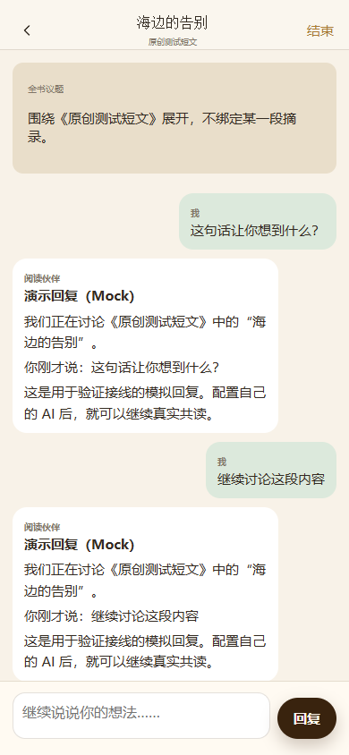

# 共读岛 · Reading Island

**接入你自己的 AI，一起读一本书，围绕内容持续讨论。**

A reusable reading space for you and your own AI: books, chapters, excerpts, and ongoing discussions.

共读岛可以独立部署，也可以嵌入已有网站。界面不绑定 React/Vue，AI 接口不绑定某个 Agent 框架。首版提供 **Cloudflare 参考后端和完整部署示例**；使用其他后端需要实现同一 HTTP 接口，尚无其他后端适配器。

## 能做什么

- 导入书籍，管理分组、书籍资料和章节，保存阅读位置。
- 选择原文保存摘录与想法，围绕摘录或整本书发起独立议题。
- 同一议题连续对话，不同议题隔离，保存 Markdown 回复、引用和未读状态。
- 冻结原文版本；替换文档后，旧摘录继续引用旧版本。
- AI 按需读取当前议题授权的原文范围，不默认把整本书发送给模型。
- 接入自己的已有 Agent，或使用 Chat Completions 兼容模型 API。
- 电脑端使用分类侧栏、宽幅阅读面板和书籍网格；搜索/标题/插图固定，书架独立滚动。插图可替换、取消或恢复默认，外观只保存在当前浏览器。

## 快速开始

**只有 API Key 的使用者，从这里开始：[零基础部署与 DeepSeek 接入](docs/START-HERE.md)。**

[](https://deploy.workers.cloudflare.com/?url=https://github.com/birdisleeee/reading-island)

流程：自己的 CF/GitHub 账户 → 开通自己的 R2 → 部署按钮 → 登录网站 → 选择 DeepSeek、填 Key → 测试成功 → 保存共读。无需先搭建 Agent。也可以把 [LLM 操作指引](docs/LLM-DEPLOY-GUIDE.md)交给自己的助手。官方按钮按此配置准备，尚未在新 CF 账户走完实机部署；浏览器接入流程已通过协议替身验收。

下面是本地开发方式。

需要 Node.js 22 或更新的 LTS 版本。默认 Mock 模式无需模型 key，也不会调用真实 AI。

```sh
git clone https://github.com/birdisleeee/reading-island.git
cd reading-island
npm ci
```

将 `.dev.vars.example` 复制为 `.dev.vars`，填写两个不同随机值 `READER_TOKEN` 和 `SESSION_SECRET`，然后：

```sh
npm run dev
```

打开 [本地共读岛](http://127.0.0.1:4187/reading-island/)，使用 `.dev.vars` 的 `READER_TOKEN` 登录。点击“添加书籍”，导入 [原创示例短文](examples/sample-book.txt)。讨论中的 **Mock** 标记说明当前是模拟回复。

本地开发使用 Wrangler 的隔离 DO/R2 模拟存储。正式部署使用部署者自己的云端资源，关闭开发电脑不会关闭已部署的站点。

## 接入 AI 和已有项目

| 接线 | 配置 | 状态 |
| --- | --- | --- |
| Mock | `AI_MODE=mock` | 完整本地共读流程已验证，无真实模型调用 |
| 模型 API | 网页选择 DeepSeek/兼容接口，填 Key、测试并保存；也保留服务端配置方式 | 文字、工具、加密保存与真实 workerd 请求已用替身验证；真实账户需实测 |
| 已有 Agent | `AI_MODE=webhook`，配置 HTTPS endpoint 和独立共享密钥 | HTTP 示例、签名和幂等已验证；将示例回复函数接到自己的 Agent |

模型 key 只在后端使用。已有 Agent 继续管理自己的人格和长期记忆，共读模块仅提供独立议题会话与书籍内容接口。

DeepSeek 的地址/模型预设按2026-10-13 [官方文档](https://api-docs.deepseek.com/)核对；无需复制模型Key到Cloudflare Secrets。网页保存的设置优先于本实例的模型环境变量，Key以AES-GCM加密存储，不回显、不写浏览器本地存储或Git。

- [Cloudflare 部署](docs/DEPLOYMENT.md)
- [零基础使用](docs/START-HERE.md)
- [让自己的 LLM 协助部署](docs/LLM-DEPLOY-GUIDE.md)
- [AI 接入与协议](docs/AI-INTEGRATION.md)
- [嵌入已有网站及登录接线](docs/EMBEDDING.md)
- [HTTP 接口与格式说明](docs/API.md)
- [贡献指南](CONTRIBUTING.md)

## 首版边界

TXT、Markdown、HTML 和无加密 DOCX/EPUB 可提取正文。PDF、DOC、MOBI、AZW/AZW3 保留原件，首版不提供 OCR、DRM 解密或精准正文摘录。复杂 EPUB/DOCX 可能退回原件模式。

首版不包含语音、图片对话、多人群聊、npm 组件包、跨域嵌入登录桥或其他后端。模型输出与工具兼容性须按所选供应商实测；付费模型和真实 Agent 未在发行测试中调用。已开始但结果不明的 AI 请求不会自动重复生成，接入方需按原请求身份核查。

## 开发与验证

```sh
npm test
npm run check
npm audit --audit-level=high
```

验证包括真实 workerd SQLite/R2 模拟运行、跨用户隔离、冻结版本、重复发送/回调、重建后持久化、DOCX/EPUB 合成格式、模型工具范围和 Agent HTTP 示例。手机/桌面浏览器已走通导入、章节、讨论、连续回复和刷新；这些是合成数据与 Mock 验证。

下面是原创测试短文的实际页面，回复为 Mock：



## 许可和维护

本项目代码与原创示例采用 [MIT](LICENSE)。第三方代码使用各自许可，见 [第三方声明](THIRD_PARTY_NOTICES.md)。代码许可不授予任何用户上传书籍的再分发权。

本仓库独立维护。后续修复默认只作用于本仓库；同步到外部项目由其维护者明确决定、单独验证和发布。
