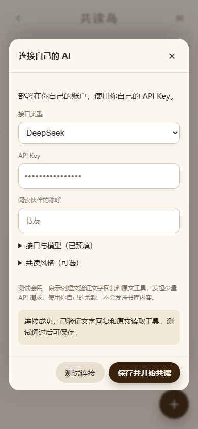

# 从零部署：自己的账户 + 一个模型 Key

这份教程用于安装自己的共读岛。直接使用制作者网页 / APK、或已经进入书架的读者，请看 [普通用户使用说明](USER-GUIDE.md)；已有 Agent 请看 [Agent 接入手册](AGENT-GUIDE.md)。下面用 DeepSeek 预设演示模型接入。

目标：只部署一次自己的共读岛。以后打开网站，在页面填 Key、测试、保存，然后读书讨论。书库、模型配置和费用都属于你自己的账户，自行部署不占公共名额。另有可选的[公共服务申请与 APK](USER-GUIDE.md#使用制作者的网页或-apk)，需要人工批准并受配额限制。

## 准备三件事

- 一个自己的 GitHub 账户：用来保存你复制的项目。
- 一个自己的 [Cloudflare 账户](https://dash.cloudflare.com/sign-up)：用来运行网站、保存书籍与讨论。
- 一个自己的 [DeepSeek API Key](https://platform.deepseek.com/api_keys)：它是 API 平台的 Key，需要账户中有可用的 API 余额；网页登录聊天的账号本身不能替代 Key。

不用先买服务器或域名。可先使用 Cloudflare 提供的 [workers.dev 地址](https://developers.cloudflare.com/workers/configuration/routing/workers-dev/)。

## 第一次部署

1. 注册并登录自己的 Cloudflare。在菜单 **Storage & databases → R2 → Overview** 开通 R2。它保存你上传的书籍；Cloudflare 会要求你确认账户订阅/支付信息，由你本人完成。R2 有免费用量，但并非承诺所有用量永久免费。依据：[R2 官方开通说明](https://developers.cloudflare.com/r2/get-started/)。
2. 打开下面的部署入口，登录自己的 GitHub/Cloudflare，允许 Cloudflare 在**自己的 GitHub**复制项目。账户选择应当是你本人。

3. 使用新 Worker 名称。确认页面列出 `BOOK_BUCKET`（R2）和 `READING_LIBRARY`（Durable Object）；保留这两个代码 binding 名，可按页面提示为自己的资源命名。
4. 设置两项秘密值，使用密码管理器生成两份不同随机值，存入自己的密码管理器：

| 名称 | 填什么 |
| --- | --- |
| `READER_TOKEN` | 自己共读岛的访问密码，用来登录网站 |
| `SESSION_SECRET` | 独立的至少32字符随机密钥，用于登录会话与加密保存 AI 配置 |

这里不用填 DeepSeek Key。不要沿用仓库里的演示值。`SESSION_SECRET` 请长期保留；更换它后旧会话失效，原来加密保存的模型 Key 需要重新填写。

5. 若部署页面要求确认命令，构建选 `npm run build`，部署可选 `npx wrangler deploy`；工作目录是仓库根目录，Node 使用22或更新的 LTS。仓库的自带 `npm run deploy` 也会构建并部署。
6. 点击部署并等待成功。Cloudflare 官方部署流程支持按 Wrangler 配置创建、绑定 R2 和 Durable Objects。[官方流程](https://developers.cloudflare.com/workers/platform/deploy-buttons/)
7. 打开得到的 `https://你的实例.你的子域.workers.dev/reading-island/`，用第4步的访问密码登录。

部署入口按官方配置准备；项目维护者未代你在全新 Cloudflare 账户执行该流程。若账户权限、订阅或页面步骤不同，以你看到的实际提示为准，使用 [LLM 操作指引](LLM-DEPLOY-GUIDE.md)协助处理；需要命令行时使用 [备用部署流程](DEPLOYMENT.md)。不要为绕过报错删除已有书库。

## 连接 DeepSeek：填 Key → 测试 → 保存

1. 进入书架，打开 **设置 → AI 接入与人物预设**。电脑端设置在左侧导航底部，手机在书架右上角菜单的右侧抽屉中；阅读或讨论页面也能从电脑侧栏打开。
2. 接口类型选 **DeepSeek**，只需填自己的 API Key，可修改阅读伙伴的称呼和共读风格。接口与模型已预填在折叠的高级项中。
3. 点击 **测试连接**。它使用原创示例短文测试文字回复和 `read_source` 工具，一般需要两次小型 API 请求；不读取你的真实书库，费用使用你的 API 余额。
4. 看到“连接成功，已验证文字回复和原文读取工具”后，点击 **保存并开始共读**。
5. 设置以加密形式保存在自己实例的后端；页面再次打开时 Key 显示为空，提示“已保存，留空沿用”。换设备用同一访问密码登录即可使用，无需再填 Key。

当前预设：完整地址 `https://api.deepseek.com/chat/completions`，模型 `deepseek-flash`。这是2026-10-13按 [DeepSeek 官方接口](https://api-docs.deepseek.com/)核对的名称。供给方之后可能调整名称；可以在“接口与模型”中改成自己账户当前支持的模型。本项目的 DeepSeek 预设明确关闭思考模式，以使用已实现的文本/工具回合；思考模式有额外消息回传要求，尚未提供该开关。[官方说明](https://api-docs.deepseek.com/guides/thinking_mode/)

## 开始共读

点击 **添加书籍**，可先导入仓库 [原创短文](../examples/sample-book.txt)。打开章节阅读，选中一句话保存摘录或发起讨论，也可在书籍的“讨论”页新建议题。

一个 Key 足以完成模型型共读，不用先安装 Agent、配置 Webhook 或开 Tunnel。系统提供每个议题的对话历史、摘录与有限原文工具；它不会自动变成已有 Agent 的长期记忆系统。

设置中的“美化设置”可改主题和背景；进入原文后轻点中间呼出阅读工具，可即时调整字体字号，右上角三个点打开完整阅读排版。人物预设、分类折叠与定时议题的使用方式见[设置说明](SETTINGS.md)和[定时议题](TOPIC-SCHEDULE.md)。定时任务默认暂停，启用后使用自己的模型余额。

## 常见情况

- 登录提示未配置：确认自己的 Worker 有 `READER_TOKEN` 与 `SESSION_SECRET` Secrets，保存后重试。
- Key 无效：检查是不是 API Key、是否复制完整、该模型是否有权限；不要把完整 Key 发到聊天或 issue。
- 余额问题：去自己的 DeepSeek API 平台查看。共读岛不会代扣维护者的余额。
- 测试成功后保存不可点：测试期间或之后改过模型、称呼、风格或 Key；重新测试当前内容即可。测试凭据10分钟有效。
- 文字能回答但工具测试失败：该接口/模型不兼容工具调用，不能把纯文字成功当作能读取原文。换支持工具的模型。
- Cloudflare 资源创建失败：先核对自己的 R2 开通与账户权限，保存脱敏报错，再查官方说明；不要绑定他人的账户或资源。

验证状态：加密配置、测试/保存、刷新、跨用户隔离和原文工具已在 workerd 隔离环境及手机/桌面浏览器通过。验证使用 DeepSeek 协议替身，未调用真实付费 Key，也未在全新 CF 账户完成官方部署按钮的实机闭环。真实部署者应完成自己实例上的一次测试和共读。
